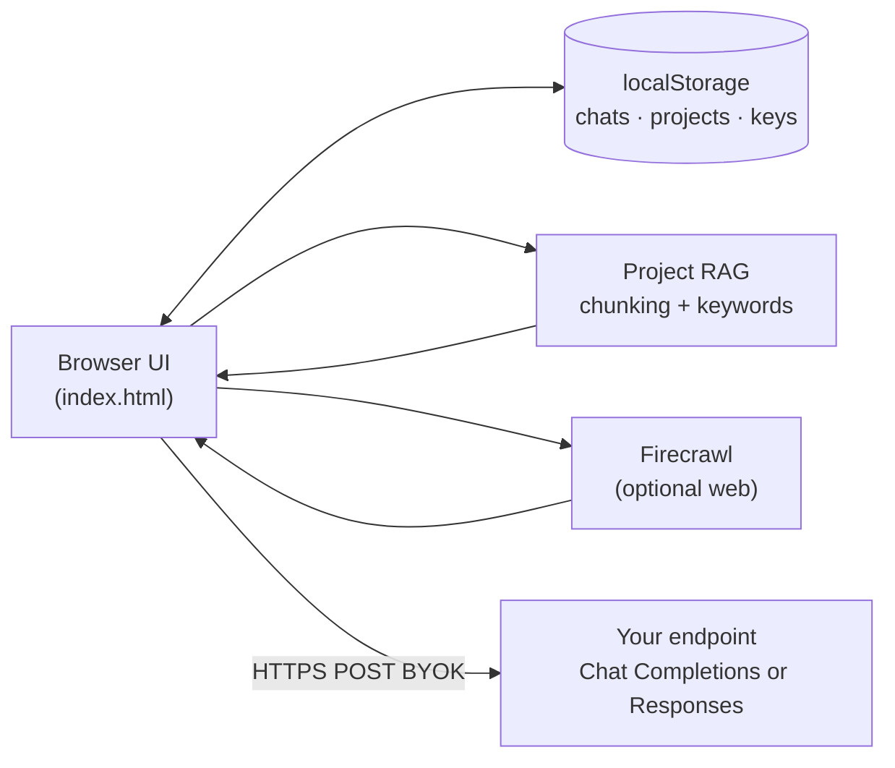

# Local LLM Harness

**Zero-dependency, local-first BYOK chat & RAG harness** — a single-page PWA that talks to OpenAI Chat Completions, OpenRouter, Vercel AI Gateway, Ollama/LM Studio, Meta AI Responses API, or any compatible endpoint you configure.

> Optional: rename this repository in GitHub **Settings → General** to `local-llm-harness` when you want a clearer public slug.

## Architecture



## Key features

- **Multi-provider BYOK** — Provider presets + custom URL; API key optional on `localhost` / `127.0.0.1` (Ollama, LM Studio, vLLM).
- **Dual protocol** — Auto-detect or force **Chat Completions** (`messages`, `temperature`) or **Responses API** (`input` blocks).
- **Any model ID** — Free-form model field with suggestions (not locked to one vendor).
- **Local-first** — Chats, settings, projects, and memory in `localStorage` (existing project keys preserved).
- **RAG** — Per-project files with client-side chunking; memory keyword RAG; per-message attachments.
- **Observability** — Assistant footers show latency (ms) and token usage when the API returns `usage`.
- **Export / import** — JSON backup including chats, settings, and projects.
- **PWA** — Installable; optional Firecrawl when “Web browsing” is enabled.

## Provider compatibility

| Provider | Endpoint (preset) | API format | API key |
|----------|-------------------|------------|---------|
| OpenAI | `https://api.openai.com/v1/chat/completions` | Chat Completions | Required |
| OpenRouter | `https://openrouter.ai/api/v1/chat/completions` | Chat Completions | Required |
| Vercel AI Gateway | `https://ai-gateway.vercel.sh/v1/chat/completions` | Chat Completions | Required |
| Ollama (local) | `http://localhost:11434/v1/chat/completions` | Chat Completions | Optional |
| LM Studio / vLLM | `http://127.0.0.1:…/v1/chat/completions` | Chat Completions | Optional |
| Meta AI | `https://api.meta.ai/v1/responses` | Responses | Required |
| Custom | Your URL | Auto or manual | Depends on host |

Use **Settings → API format → Auto** unless you need to override detection (`/responses` → Responses API).

## Quickstart

### Local

```bash
git clone https://github.com/zman77-boop/muse-1-2-chat.git
cd muse-1-2-chat
python3 -m http.server 8000
```

Open `http://localhost:8000` (not `file://`). Pick a **provider preset**, set model + key if needed, **Save**, then **Test connection**.

### Vercel

```bash
npx vercel --prod
```

Static output: `.` (`index.html`, `lib/`, `vercel.json`).

### Tests (CI)

```bash
node --test tests/harness.test.mjs
```

GitHub Actions runs this on Node 22 (see `.github/workflows/ci.yml`).

## Privacy & security

| Data | Stored | Transmitted to |
|------|--------|----------------|
| API keys | `localStorage` | Only the endpoint URL you configure |
| Firecrawl key | `localStorage` | `api.firecrawl.dev` when browsing is on |
| Chats / projects / memory | `localStorage` | Included in prompts you send to your LLM endpoint |

No backend in this repo — the browser calls providers directly (subject to each provider’s CORS policy).

## License

MIT — see [LICENSE](LICENSE).